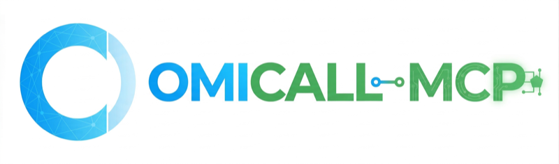

<p align="center">
  
</p>

<p align="center">
  <a href="https://www.npmjs.com/package/omicall-mcp"></a>
  <a href="https://www.npmjs.com/package/omicall-mcp"></a>
  <a href="https://github.com/VIHATTeam/OMICALL-MCP/blob/main/LICENSE"></a>
  <a href="https://smithery.ai/server/omicall-mcp"></a>
</p>

# OMICall MCP Server

Connect AI assistants (Claude, Codex, Cursor, Windsurf, VS Code, …) to your [OMICall](https://omicall.com/) / [OMICRM](https://omicrm.com/) contact center through the [Model Context Protocol](https://modelcontextprotocol.io/).

**101 tools in 11 groups:** call center & PBX, tickets, contacts, omnichannel chat (Zalo, Facebook, Telegram, LiveTalk), agents & notifications, webhooks, auto call, text-to-speech, AI chatbots / SmartAgent callbots, and OmiFlow automation.

> **Important:** OmiCall MCP works on your **live** contact center: real customers, real calls, real money. Read [Safety](#safety) before giving an AI assistant write access.

## Contents

- [What you can ask](#what-you-can-ask)
- [Requirements](#requirements)
- [Quick start](#quick-start)
- [Configuration](#configuration)
- [Setup per client](#setup-per-client)
- [Tools](#tools)
- [Toolsets and service package](#toolsets-and-service-package)
- [Safety](#safety)
- [Troubleshooting](#troubleshooting)
- [Changelog](#changelog) · [License](#license)

## What you can ask

| Ask (English) | Ask (Tiếng Việt) |
|---|---|
| "Show the last 5 Zalo conversations and their latest messages" | "Lấy 5 hội thoại Zalo gần nhất và tin nhắn mới nhất" |
| "How many customers did Lan add this week, tagged VIP?" | "Tuần này chị Lan thêm bao nhiêu khách, tag VIP?" |
| "List missed inbound calls today on hotline 1900xxxx" | "Liệt kê cuộc gọi đến bị nhỡ hôm nay trên hotline 1900xxxx" |
| "Create a ticket for customer 09xxxxxxxx: refund request, due Friday" | "Tạo ticket cho khách 09xxxxxxxx: yêu cầu hoàn tiền, hạn thứ Sáu" |
| "Which OmiFlow flows have errors? Show last week's report for the onboarding flow" | "Flow nào đang lỗi? Báo cáo tuần trước của flow onboarding" |
| "Show the SmartAgent script for the sales callbot: model, instructions, exit conditions" | "Xem kịch bản SmartAgent của callbot bán hàng" |
| "Turn the AI bot off for this conversation, I'll take over" | "Tắt bot AI cho hội thoại này, để tôi trả lời" |

Dates such as "today", "this week" or "on the 19th" are interpreted in Vietnam time (UTC+7).

## Requirements

- **Node.js 18 or newer** (`node --version`).
- An OmiCall account (email + password), or an OmiCall API key.

## Quick start

Claude Code:

```bash
claude mcp add omicall --scope user \
  -e OMICALL_USERNAME=admin@company.com \
  -e OMICALL_PASSWORD=your-password \
  -e OMICALL_DOMAIN=your-company \
  -- npx -y omicall-mcp
```

Then ask: *"Log in to OmiCall and show my service package."* The server logs in automatically on the first tool call (no explicit login needed) and keeps one session per account in `~/.omicall-mcp/`, so several tenants can run side by side.

## Configuration

| Variable | Required | Description |
|---|---|---|
| `OMICALL_USERNAME` | yes¹ | Login email |
| `OMICALL_PASSWORD` | yes¹ | Login password |
| `OMICALL_DOMAIN` | yes¹ | Company domain (the part you use to sign in) |
| `OMICALL_API_KEY` | — | API key; used instead of email/password when those are not set |
| `OMICALL_TENANT_ID` | — | Tenant to select when the account belongs to several (auto-selected when there is only one) |
| `OMICALL_TOOLSETS` | — | Comma-separated tool groups to load, e.g. `ticket,contact` — see [Toolsets](#toolsets-and-service-package). Default: all |
| `OMICALL_ENV` | — | Not needed. OmiCall has a single live environment |

¹ Email/password login (recommended). With `OMICALL_API_KEY` set, these can be omitted.

## Setup per client

All clients use the same command (`npx -y omicall-mcp`) and environment variables. The server name (`omicall` below) is your choice; permission rules refer to it as `mcp__<name>__<tool>`.

<details>
<summary><strong>Claude Code</strong></summary>

Global (all projects):

```bash
claude mcp add omicall --scope user \
  -e OMICALL_USERNAME=admin@company.com \
  -e OMICALL_PASSWORD=your-password \
  -e OMICALL_DOMAIN=your-company \
  -- npx -y omicall-mcp
```

Per project, in `.mcp.json`:

```json
{
  "mcpServers": {
    "omicall": {
      "command": "npx",
      "args": ["-y", "omicall-mcp"],
      "env": {
        "OMICALL_USERNAME": "admin@company.com",
        "OMICALL_PASSWORD": "your-password",
        "OMICALL_DOMAIN": "your-company"
      }
    }
  }
}
```

Recommended permissions in `~/.claude/settings.json` — auto-approve read tools only, keep a prompt for anything that writes:

```json
{
  "permissions": {
    "allow": [
      "mcp__omicall__search_*",
      "mcp__omicall__get_*",
      "mcp__omicall__list_*",
      "mcp__omicall__count_*",
      "mcp__omicall__ticket_statistics",
      "mcp__omicall__flow_report",
      "mcp__omicall__flow_execution_history",
      "mcp__omicall__callbot_api_report"
    ]
  }
}
```

> ⚠️ **Warning:** allowing `mcp__omicall__*` also skips confirmation for sending messages, placing calls, deleting records, changing SIP passwords and resuming flows.
</details>

<details>
<summary><strong>Claude Desktop</strong></summary>

Edit `~/Library/Application Support/Claude/claude_desktop_config.json` (macOS) or `%APPDATA%\Claude\claude_desktop_config.json` (Windows):

```json
{
  "mcpServers": {
    "omicall": {
      "command": "npx",
      "args": ["-y", "omicall-mcp"],
      "env": {
        "OMICALL_USERNAME": "admin@company.com",
        "OMICALL_PASSWORD": "your-password",
        "OMICALL_DOMAIN": "your-company"
      }
    }
  }
}
```
</details>

<details>
<summary><strong>OpenAI Codex (CLI / IDE)</strong></summary>

Add to `~/.codex/config.toml`:

```toml
[mcp_servers.omicall]
command = "npx"
args = ["-y", "omicall-mcp"]
startup_timeout_sec = 30   # first run downloads the package
env = { OMICALL_USERNAME = "admin@company.com", OMICALL_PASSWORD = "your-password", OMICALL_DOMAIN = "your-company" }
```

OpenAI models handle a limited number of tools per request — if you also use other MCP servers, load only the groups you need, e.g. `OMICALL_TOOLSETS = "ticket,contact"` inside `env`.
</details>

<details>
<summary><strong>Cursor</strong></summary>

Edit `~/.cursor/mcp.json` (global) or `.cursor/mcp.json` (project):

```json
{
  "mcpServers": {
    "omicall": {
      "command": "npx",
      "args": ["-y", "omicall-mcp"],
      "env": {
        "OMICALL_USERNAME": "admin@company.com",
        "OMICALL_PASSWORD": "your-password",
        "OMICALL_DOMAIN": "your-company"
      }
    }
  }
}
```
</details>

<details>
<summary><strong>Windsurf</strong></summary>

Edit `~/.codeium/windsurf/mcp_config.json`:

```json
{
  "mcpServers": {
    "omicall": {
      "command": "npx",
      "args": ["-y", "omicall-mcp"],
      "env": {
        "OMICALL_USERNAME": "admin@company.com",
        "OMICALL_PASSWORD": "your-password",
        "OMICALL_DOMAIN": "your-company"
      }
    }
  }
}
```
</details>

<details>
<summary><strong>VS Code (Copilot / Cline)</strong></summary>

Edit `.vscode/mcp.json`:

```json
{
  "servers": {
    "omicall": {
      "command": "npx",
      "args": ["-y", "omicall-mcp"],
      "env": {
        "OMICALL_USERNAME": "admin@company.com",
        "OMICALL_PASSWORD": "your-password",
        "OMICALL_DOMAIN": "your-company"
      }
    }
  }
}
```
</details>

## Tools

**Impact:** 📖 read only · ✏️ changes data · ⚠️ high impact (customer-facing, costly or hard to undo — clients that honor MCP annotations ask for confirmation).

Each heading shows the toolset key (for `OMICALL_TOOLSETS`) and the service-package module it needs.

### Auth · `auth` · always on

| Tool | Description | Impact |
|---|---|---|
| `login_omicall_mcp` | Log in explicitly or switch domain (pre-auth → tenant → token). Not needed normally: the first tool call logs in | ✏️ |
| `select_tenant` / `logout` | Switch tenant; log out and clear the saved session | ✏️ |
| `get_balance` / `get_service_package` | Account balance; enabled modules and limits | 📖 |
| `get_version` | Version of the running server | 📖 |

### Call center & PBX · `callcenter` · module `switchboard`

| Tool | Description | Impact |
|---|---|---|
| `search_calls` / `get_call_detail` | Call history with filters (date, direction, number, agent, tags); call detail | 📖 |
| `update_call` | Set your own note on a call you handled | ✏️ |
| `list_eval_criteria` / `evaluate_call` | Evaluation criteria; score a call | 📖 / ✏️ |
| `click_to_call` | Start an outbound call from an extension | ⚠️ |
| `list_extensions` / `get_extension` | Extensions (SIP passwords are never returned) | 📖 |
| `update_extension_status` | Enable/disable extensions | ✏️ |
| `update_extension` | Change an extension's settings or SIP password | ⚠️ |
| `list_hotlines` / `get_hotline` / `update_hotline` | Hotlines; turn inbound/outbound on or off, change the inbound script | 📖 / ⚠️ |
| `list_groups` / `update_group` / `delete_group` | Ring groups: name, ring strategy | 📖 / ✏️ / ⚠️ |
| `list_ivr` / `update_ivr` / `delete_ivr` | IVR menus: name, greeting, timeout | 📖 / ✏️ / ⚠️ |
| `list_scripts` / `update_script` / `delete_script` | Call scripts | 📖 / ✏️ / ⚠️ |
| `list_audio` / `delete_audio` | Greeting / audio files | 📖 / ⚠️ |

### Tickets · `ticket` · module `ticket`

| Tool | Description | Impact |
|---|---|---|
| `search_tickets` / `get_ticket` | Search by date range and keyword; ticket detail | 📖 |
| `create_ticket` / `update_ticket` | Create (category, assignees, reporters, tags, due date); edit title, description, priority, assignee, due date | ✏️ |
| `update_ticket_status` | Move a ticket to another status | ✏️ |
| `create_ticket_note` / `update_ticket_note` | Internal notes (never shown to the customer) | ✏️ |
| `list_ticket_interactions` | Notes and history of a ticket | 📖 |
| `get_ticket_eval_criteria` / `create_ticket_evaluation` | Evaluation criteria; evaluate a ticket | 📖 / ✏️ |
| `get_ticket_categories` / `ticket_statistics` | Categories; counts by status and assignee | 📖 |
| `delete_ticket` / `delete_ticket_note` | Delete | ⚠️ |

### Contacts · `contact` · module `customer`

| Tool | Description | Impact |
|---|---|---|
| `search_contacts` | Server-side filters: created date, owner, creator, tags, groups, business type, status. Rows already include owner, creator, created date, tags and status | 📖 |
| `count_contacts` | Count matches for the same filters without loading rows | 📖 |
| `get_contact_filter_options` | IDs of tags, groups, business types and status steps to filter by | 📖 |
| `get_contact` / `get_contact_by_phone` / `get_source_contacts` | Contact detail; lookup by phone; contact lists | 📖 |
| `create_contact` / `update_contact` | Create or edit a contact | ✏️ |
| `delete_contact` | Delete a contact | ⚠️ |

### Omnichannel chat · `multichannel` · module `integrated`

Channels: Zalo OA, Zalo personal, Facebook Messenger, Facebook comments, Telegram, LiveTalk (plus WhatsApp and other channels for reading). Each channel is also checked against your package.

| Tool | Description | Impact |
|---|---|---|
| `search_conversations` | Search all channels by date, last message time, channel, agent, tag, read status | 📖 |
| `get_conversation` / `get_all_channels` | Conversation detail; connected channels | 📖 |
| `search_channel_messages` | Messages of a conversation — pass its ID, the channel is detected automatically | 📖 |
| `mark_conversation_read` | Mark as read | ✏️ |
| `send_zalo_message` / `send_zalo_personal_message` | Reply via Zalo OA / Zalo personal | ⚠️ |
| `send_facebook_message` / `send_facebook_comment` | Reply via Messenger / to a post comment | ⚠️ |
| `send_telegram_message` / `send_livetalk_message` | Reply via Telegram / LiveTalk | ⚠️ |

### Agents & notifications · `agent` · no module needed

| Tool | Description | Impact |
|---|---|---|
| `list_agents` / `get_agent` / `get_agent_pbx_info` | Employees, detail, extension/PBX info | 📖 |
| `invite_agent` | Invite a new employee to the tenant | ⚠️ |
| `list_notifications` / `count_unread_notifications` | Notifications | 📖 |
| `mark_notification_read` / `mark_all_notifications_read` | Mark read | ✏️ |

### Webhooks · `webhook` · no module needed

| Tool | Description | Impact |
|---|---|---|
| `list_webhooks` | Registered webhooks (manage them in the web app → Integration) | 📖 |

### Auto call · `autocall` · module `switchboard`

| Tool | Description | Impact |
|---|---|---|
| `autocall_by_phone` | Automated calls to up to 50 numbers with TTS, recording or IVR | ⚠️ |
| `autocall_by_extension` | Automated call to an internal extension | ⚠️ |

### Text to speech · `ai` · module `ai`

| Tool | Description | Impact |
|---|---|---|
| `text_to_speech` | Vietnamese TTS, 4 voices; returns an audio URL (billed) | ✏️ |

### AI chatbots, knowledge & SmartAgent · `aiconfig` · module `ai`

| Tool | Description | Impact |
|---|---|---|
| `list_omibots` / `get_omibot` | OmiBot chatbots: status, reply mode, model, system prompt (`full: true` for the whole prompt), knowledge sources | 📖 |
| `list_ai_models` | Models available for chatbots and SmartAgent | 📖 |
| `set_conversation_bot` | Turn the AI bot on/off for one conversation (hand over to a human) | ✏️ |
| `list_knowledge_documents` / `get_knowledge_quota` | Knowledge warehouse documents; training usage | 📖 |
| `list_qa_sets` / `list_qa_cases` | FAQ sets and their questions/answers | 📖 |
| `list_ai_social_assistants` | Conversation analyzers (summary, auto-tag, ticket/contact fields) | 📖 |
| `set_ai_social_assistant_enabled` | Enable/disable a conversation analyzer | ✏️ |
| `list_callbot_scripts` / `get_callbot_script` | Voice scripts: **SmartAgent** (LLM voice agent) and CallFlow — model, instructions (`full: true` for the whole text), variables, exit conditions | 📖 |
| `list_callbot_voices` | Available voices | 📖 |
| `search_callbot_campaigns` / `get_callbot_campaign` | Outbound callbot campaigns and their configuration | 📖 |
| `pause_callbot_campaign` | Pause a running campaign | ✏️ |
| `search_callbot_api_sessions` / `callbot_api_report` | API-triggered callbot sessions and totals | 📖 |

### OmiFlow automation · `omiflow` · module `campaign`

| Tool | Description | Impact |
|---|---|---|
| `list_flows` / `list_flows_with_errors` | Flows with state (active, paused, ended, …), trigger, version; flows with failed steps | 📖 |
| `get_flow` | Schedule and every step of a flow | 📖 |
| `flow_report` / `flow_execution_history` | Sessions and credits per day and per step; recent runs | 📖 |
| `pause_flow` | Pause a flow (stops sending) | ✏️ |
| `resume_flow` | Resume a flow — it starts messaging/calling customers again | ⚠️ |

Building or editing bots, scripts and flows, training knowledge, starting campaigns, creating ring groups / IVR / scripts, and registering webhooks are done in the OmiCall web app.

## Toolsets and service package

**Hide what you don't need.** Every tool definition costs context in your AI client. Load only the groups you use with `OMICALL_TOOLSETS` (the `auth` tools are always included):

```json
"env": { "OMICALL_TOOLSETS": "ticket,contact" }
```

| Toolset | Tools¹ | ≈ Tokens¹ | Module |
|---|---|---|---|
| *(all)* | 101 | 19.6k | — |
| `callcenter` | 30 | 4.9k | `switchboard` |
| `ticket` | 20 | 3.3k | `ticket` |
| `multichannel` | 17 | 3.2k | `integrated` |
| `contact` | 15 | 3.2k | `customer` |
| `agent` | 14 | 1.6k | — |
| `webhook` | 7 | 0.8k | — |
| `autocall` | 8 | 1.7k | `switchboard` |
| `ai` | 7 | 0.9k | `ai` |
| `aiconfig` | 24 | 3.9k | `ai` |
| `omiflow` | 13 | 2.0k | `campaign` |

¹ Including the 6 `auth` tools.

**Package-aware.** After login, groups whose module is not in your OmiCall service package are hidden automatically (the client is notified to refresh its tool list). Calling a tool of a disabled module returns *"Module X is not enabled in your service package."*

## Safety

OmiCall MCP is built for AI agents acting on a live system:

- **Untrusted content is labelled.** Text written by customers or staff (messages, tickets, contacts, bot prompts, flow names) is returned inside `<untrusted_data>` so the assistant treats it as data, not instructions — a chat message saying "ignore your instructions and…" cannot steer it.
- **Write tools say so.** Every tool carries MCP annotations (read-only / changes data / high impact). Tools with outside effects tell the assistant to run them only when you asked for that action.
- **Rate limits per session** stop runaway loops: 30 messages/min, 100 outbound call legs/hour, 30 deletes/min, 10 automation on/off switches per 10 min.
- **Permissions follow the web app.** Ticket, contact, OmiFlow, callbot and AI-assistant actions check your OmiCall role; the conversation bot switch requires the tenant owner or an agent who joined the conversation. OmiCall's servers enforce permissions as well.
- **Secrets stay out of answers.** SIP passwords, tokens and API keys are redacted, including keys pasted into bot prompts.
- **Bounded inputs.** Every parameter has a size limit; page size is at most 50.
- **Session files** in `~/.omicall-mcp/` (one per account/domain) are readable only by you (`0600`); a session is only ever reused by the account it belongs to.

Recommended: auto-approve read tools only (see [Claude Code setup](#setup-per-client)) and keep confirmation for ✏️ and ⚠️ tools.

## Troubleshooting

**`ETARGET` / "No matching version found", or an older version keeps running** — npx is using a stale cache. Clear it and run the latest:

```bash
rm -rf ~/.npm/_npx
npx -y omicall-mcp@latest
```

Ask the assistant to run `get_version` to see which version is actually running.

**Server disconnects on startup** — check Node.js is 18 or newer (`node --version`).

**"Module X is not enabled in your service package"** — the feature is not in your OmiCall plan; contact OmiCall to enable it.

**"Permission denied … requires role …"** — your OmiCall role does not allow that action; ask your administrator.

**Account with several tenants** — set `OMICALL_TENANT_ID`, or ask the assistant to run `select_tenant`; otherwise tools answer *"This account belongs to several tenants…"*.

**"Rate limit reached"** — a safety limit for this session; wait for the time shown, or do bulk work in the OmiCall web app.

**A record created a moment ago is not found** — search results update a few seconds after creation; retry shortly.

## Changelog

See [CHANGELOG.md](CHANGELOG.md).

## License

MIT
